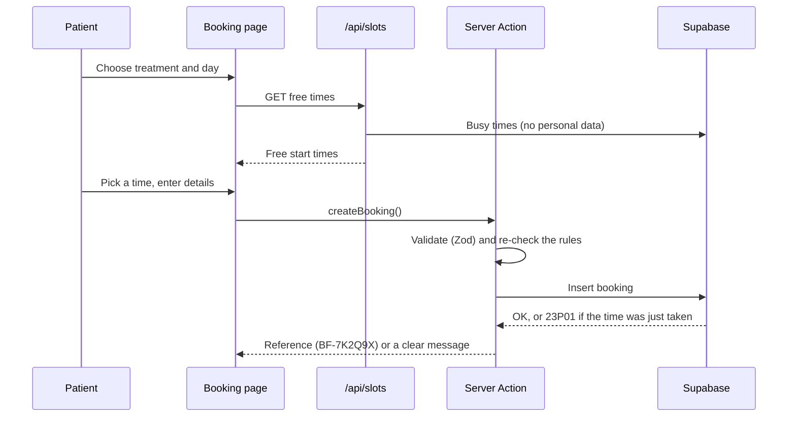

<div align="center">


# BookFlow

**A smart booking website for service businesses.**
Patients see real free times and book in under a minute. The owner confirms or cancels from a simple dashboard.

Demo client: **Nefer Dental Studio**, a fictional dental clinic in Cairo.

Next.js 16 · React 19 · TypeScript · Tailwind CSS 4 · Supabase · Zod · React Hook Form

</div>

---

## Highlights

- **Live availability.** Only free times are shown, computed from working hours, the treatment's length, a 15-minute sterilization buffer between patients, a 2-hour minimum notice and a 30-day booking window.
- **No double bookings, ever.** A PostgreSQL exclusion constraint rejects overlapping bookings, even when two people press "Confirm" in the same millisecond. The losing patient gets a clear message and fresh times.
- **Validated twice.** One Zod schema checks the form in the browser (React Hook Form) and again in the Server Action.
- **Secure by default.** Row Level Security everywhere: visitors can only read active services, patients never touch the bookings table directly, and the owner can read bookings and change only their status.
- **Owner dashboard.** Today's numbers, filters in the URL, search by name, phone or reference, confirm and cancel.
- **A design with a point of view.** Real photos set in domed faience tiles (after the tile walls in Djoser's tomb at Saqqara), a Treatments mega menu with prices, a live "Open now" status in Cairo time, a price list set like a menu, an interactive tooth-shade guide, an evening band with live free times, a studio lightbox on `<dialog>`, and a hand-drawn SVG map of Zamalek.
- **Dropdowns done properly.** One menu-button component (WAI-ARIA pattern: arrow keys, Escape, click outside) powers the clinic menu, the services sort and "Add to calendar" (Google Calendar or an .ics file with a reminder).
- **Accessible.** Keyboard-friendly calendar, visible focus, labelled fields, WCAG AA contrast (checked with a script), reduced-motion support.
- **Designed before coded.** PRD → design system → wireframe → code. See [`docs/`](docs).

## Screenshots

> Add screenshots after the first deployment: `docs/screenshots/home.png`, `booking.png`, `dashboard.png`.

## Tech stack

| Layer | Tool |
|---|---|
| Framework | Next.js 16.4 (App Router, Server Components, Server Actions, Route Handlers, Proxy) |
| Language | TypeScript (strict) |
| Styling | Tailwind CSS 4 (Turbopack loader) with design tokens (`src/app/globals.css`) |
| Database and auth | Supabase: PostgreSQL, Row Level Security, email and password login |
| Forms | React Hook Form + Zod |
| Animation | Motion, plus one CSS entrance animation |
| Tests | Vitest (booking logic) |
| Hosting | Vercel |

## Run it locally

```bash
npm install
npm run dev
```

Open http://localhost:3000. The site works straight away on sample data. Bookings are saved once Supabase is connected.

## Connect Supabase

1. Create a project at [supabase.com](https://supabase.com).
2. In **SQL Editor**, run the files in `supabase/migrations/` in order (schema first, then the seed).
3. Copy `.env.example` to `.env.local` and fill in the values from **Project Settings → API Keys**:
   - `NEXT_PUBLIC_SUPABASE_URL`
   - `NEXT_PUBLIC_SUPABASE_PUBLISHABLE_KEY`
   - `SUPABASE_SECRET_KEY` (server only, never commit it)
4. Create the owner in **Authentication → Users → Add user** (email and password, auto-confirm), then run:
   ```sql
   insert into public.admin_users (user_id)
   select id from auth.users where email = 'owner@your-clinic.com';
   ```
5. In **Authentication → Sign In / Providers**, turn off "Allow new users to sign up".
6. Restart `npm run dev`, book an appointment, then sign in at `/admin`.

## Scripts

| Command | What it does |
|---|---|
| `npm run dev` | Development server |
| `npm run build` | Production build (includes the type check) |
| `npm start` | Serve the production build |
| `npm run lint` | ESLint |
| `npm run typecheck` | TypeScript only |
| `npm test` | Unit tests for the booking logic |
| `npm run format` | Prettier, with Tailwind class sorting |

## How a booking works



## Project structure

```
src/
  app/
    (site)/            public pages: home, services, book, confirmation
    admin/             owner login and dashboard
    api/slots/         free times as JSON
  actions/             Server Actions (booking, admin)
  components/          ui, site, landing, services, booking, admin
  config/clinic.ts     business settings and booking rules
  content/home.ts      home page copy
  data/services.ts     sample services (used before Supabase is connected)
  lib/
    booking/           pure booking logic + tests
    supabase/          server, public and admin clients, session proxy
    validation/        Zod schemas
  proxy.ts             protects /admin (Next.js 16 proxy)
supabase/migrations/   schema, RLS policies, seed data
docs/                  PRD, roadmap, design system, brand assets
```

## Documentation

- [Product requirements (PRD)](docs/PRD.md)
- [Roadmap](docs/ROADMAP.md)
- [Design system](docs/DESIGN-SYSTEM.md) and [design tokens](docs/design/tokens.css)

## Make it yours

BookFlow is white-label: change `src/config/clinic.ts` (name, hours, booking rules), `src/content/home.ts` (copy), `src/content/photos.ts` (photos), the services table, and the role tokens in `src/app/globals.css`.

## Photos

All photos are from [Unsplash](https://unsplash.com) under the Unsplash License, loaded through Unsplash's image CDN by a custom `next/image` loader (`src/lib/unsplash-loader.ts`). Photographers: Katarzyna Zygnerska, Hatem Ramadan, Alexander Krivitskiy, Ani Kolleshi, Caroline LM, Quilia, Michael Starkie, Street Og', Benyamin Bohlouli, Amy Vosters, Harold Hisona, Geo Days, SoyBreno, Tony Litvyak, Jonathan Borba, Candid and Nate Johnston. The site also credits them in the footer.

---

Nefer Dental Studio, its doctor, reviews and numbers are fictional. This is a portfolio project.
