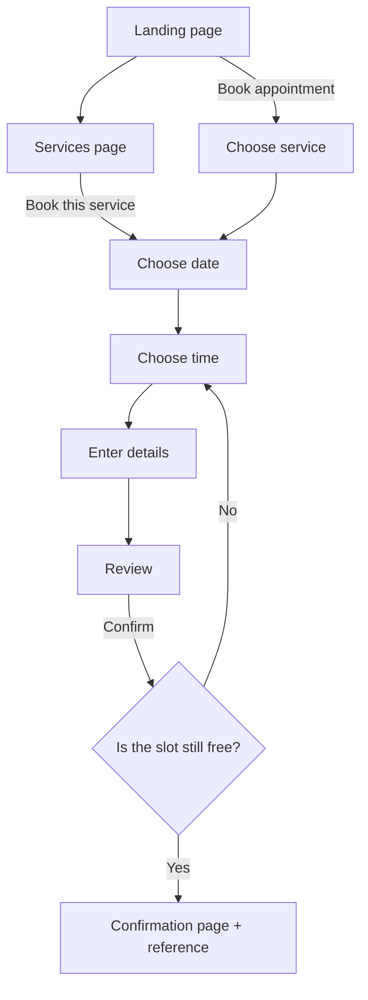
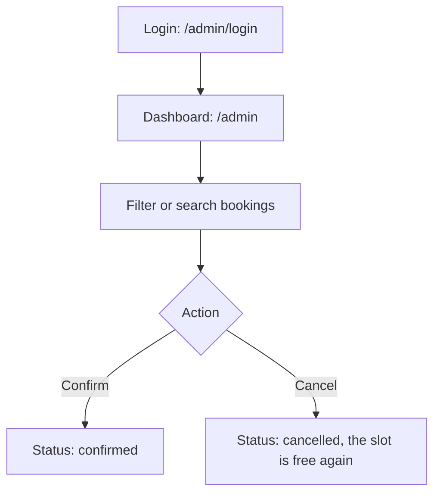
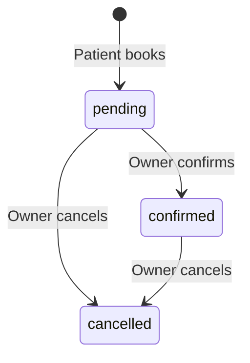
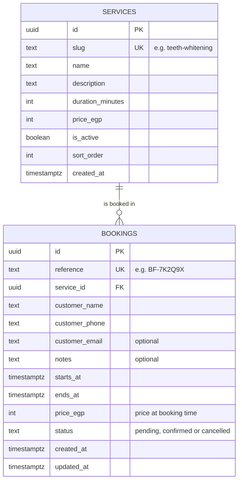

# BookFlow — Product Requirements Document (PRD)

| Field | Value |
|-------|-------|
| **Product** | BookFlow — Smart Booking Website |
| **Version** | 1.0 (MVP) |
| **Status** | Draft — in review |
| **Last updated** | 2026-11-10 |
| **Demo client** | A fictional premium dental clinic in Cairo, Egypt |
| **Site language** | English |

---

## 1. Overview

BookFlow is a smart booking website for service businesses. Patients browse the clinic's services, pick a date and an **available** time, and book an appointment in under a minute, from any device. The clinic owner manages every booking from a simple, secure dashboard.

The demo is set up for a **fictional dental clinic**. Everything specific to the business (name, services, prices, working hours) lives in configuration and in the database, so the same codebase can be reused for any service business: a barbershop, a salon, a spa, a studio or another clinic.

> The clinic's name, logo and visual identity are defined in **Phase 2 — Design System**.

## 2. The problem

- Many clinics in Egypt still take bookings by phone or WhatsApp. That means missed calls, long back-and-forth chats and double bookings.
- Patients can't see free times outside working hours, so they postpone or go somewhere else.
- The owner has no single place to see what's booked today.

## 3. Goals (MVP)

| # | Goal | How we measure it |
|---|------|-------------------|
| G1 | Patients book fast | A booking takes **less than 60 seconds** on a phone |
| G2 | No double bookings, ever | Blocked by the **database**, not only by the UI |
| G3 | The owner manages bookings easily | Confirm or cancel a booking in **2 clicks or less** |
| G4 | The site feels premium and fast | Lighthouse **90+** for Performance, Accessibility and SEO on mobile |

## 4. Users

### Patient (public visitor)
- Usually on a **phone**, often in the evening.
- Wants answers to: *What do you offer? How much is it? When can I come?*
- Doesn't want to create an account just to book.

### Clinic owner (admin)
- Uses the dashboard on a laptop at the clinic and on a phone on the go.
- Wants to see **today's appointments** first and confirm new requests quickly.
- The only person allowed to see patient data.

## 5. Scope (MoSCoW)

### Must have (MVP)
- Landing page with a premium design and subtle animations
- Services page: name, description, duration and price of every service
- Booking flow: service → date → time → details → review → confirm
- Live availability: only free time slots are shown
- Form validation in the **browser** and again on the **server**
- Bookings saved in a database (Supabase / PostgreSQL)
- Confirmation page with a booking reference (for example `BF-7K2Q9X`)
- Owner login (no public sign-up)
- Admin dashboard: list, filter and search bookings; confirm or cancel them
- Fully responsive, from small phones to large screens
- A small "Demo project" notice: the clinic, reviews and numbers are fictional

### Should have
- "Add to Google Calendar" button on the confirmation page
- Dashboard stats: today's appointments, pending requests, upcoming this week
- Custom 404 page; loading and error states everywhere
- SEO: page titles and descriptions, Open Graph image, `sitemap.xml`, `robots.txt`

### Could have (if time allows)
- Dark mode
- Confirmation email to the patient
- WhatsApp click-to-chat button

### Won't have in v1 (ideas for v2)
- Online payments or deposits
- SMS / WhatsApp reminders
- Several dentists or chairs (v1 = one appointment at a time)
- Patient accounts, or rescheduling by the patient
- Editing services and working hours from the dashboard
- Arabic version (i18n + right-to-left layout)

## 6. User stories & acceptance criteria

> **User story** = what the user wants and why. **Acceptance criteria** = the checklist that proves it works.

### US-01 — Browse services
*As a patient, I want to see all services with their price and duration, so I know what to expect before I book.*
- [ ] Each service shows its name, a short description, its duration (e.g. "45 min") and its price (e.g. "EGP 1,200").
- [ ] Each service has a **Book** button that opens the booking flow with that service already selected.
- [ ] Inactive services are hidden.

### US-02 — Pick a date and a time
*As a patient, I want to choose a date and see only the times that are still free, so I never pick a taken slot.*
- [ ] Past days, closed days and days outside the booking window are disabled.
- [ ] Only times where the whole appointment fits inside working hours are shown.
- [ ] Times that overlap a pending or confirmed booking are hidden.
- [ ] Times that start too soon (less than the minimum notice) are hidden.
- [ ] If a day is fully booked, a friendly message suggests the next available day.

### US-03 — Enter my details
*As a patient, I want clear error messages while I fill in the form, so I can fix mistakes quickly.*
- [ ] Fields: full name, mobile number, email (optional), notes (optional).
- [ ] Each error appears next to its field, in plain English.
- [ ] The server checks the same rules again; it never trusts the browser.

### US-04 — Get a confirmation
*As a patient, I want a clear confirmation, so I know my request was received.*
- [ ] After booking I see a summary (service, date, time, price) and a unique reference.
- [ ] If someone else took the same time a second before me, I see a clear message and can pick another time: no crash and no double booking.

### US-05 — Secure login
*As the clinic owner, I want to log in with my email and password, so only I can see patient data.*
- [ ] Visiting `/admin` without being logged in redirects to `/admin/login`.
- [ ] Wrong credentials show an error. There is no sign-up page.
- [ ] Patient data can't be read by anyone who isn't logged in. This is enforced by database policies, not only by hiding pages.

### US-06 — See and filter bookings
*As the owner, I want to see bookings with today's first, and filter them, so I can plan my day.*
- [ ] Filter by status (all, pending, confirmed, cancelled) and by time (today, upcoming, past).
- [ ] Search by patient name, phone number or reference.
- [ ] Works on a phone (cards) and on a desktop (table).

### US-07 — Confirm or cancel
*As the owner, I want to confirm or cancel a booking quickly, so patients know where they stand.*
- [ ] Pending can become Confirmed; Pending or Confirmed can become Cancelled.
- [ ] Cancelling asks "Are you sure?" first.
- [ ] A cancelled booking frees its time slot immediately.

## 7. Sitemap

| Route | Page | Who can open it |
|-------|------|-----------------|
| `/` | Landing page | Everyone |
| `/services` | All services | Everyone |
| `/book` | Booking flow (accepts `?service=<slug>`) | Everyone |
| `/book/confirmation/[reference]` | Booking confirmation | Everyone (shows no private data) |
| `/admin/login` | Owner login | Everyone |
| `/admin` | Dashboard | Owner only |

### Landing page sections (top to bottom)
1. **Navbar**: logo, links, "Book appointment" button
2. **Hero**: strong headline, short promise, main call-to-action, visual
3. **Trust bar**: years of experience, happy patients, rating
4. **Popular services**: 3 or 4 services, with a link to `/services`
5. **Why choose us**: 3 or 4 benefits (gentle care, modern equipment...)
6. **How booking works**: 3 simple steps
7. **Meet the doctor**: photo, name, short bio
8. **Testimonials**: patient reviews (demo content)
9. **FAQ**: questions in an accordion
10. **Final call-to-action**: "Ready for a healthier smile?"
11. **Footer**: address, working hours, phone, links, "Powered by BookFlow"

## 8. User flows

### Patient

### Clinic owner

## 9. Booking rules (the "smart" part)

All dates and times use the clinic's time zone: **Africa/Cairo**.

| Rule | Demo value |
|------|------------|
| Working days | Saturday to Thursday |
| Friday | Closed |
| Working hours | 12:00 to 22:00 |
| Time slots | Every 15 minutes |
| Buffer after each appointment | 15 minutes (to sterilize the tools) |
| Booking window | From today up to 30 days ahead |
| Minimum notice | 2 hours before the start time |
| Capacity | 1 appointment at a time |

A time is **available** only when **all** of these are true:
1. The day is a working day inside the booking window.
2. The appointment (start time + service duration) ends by closing time.
3. It starts at least 2 hours from now.
4. It doesn't overlap any pending or confirmed booking, including that booking's 15-minute buffer.

**Example:** a 45-minute cleaning is booked at 14:00. The chair is busy from 14:00 to 14:45, then the 15-minute buffer runs until 15:00, so the next booking can start at **15:00**.

### Booking status

## 10. Demo services (draft)

| Service | Duration | Price (EGP) |
|---------|----------|-------------|
| Check-up & Consultation | 30 min | 500 |
| Scaling & Polishing | 45 min | 1,200 |
| Tooth-Colored Filling | 45 min | 1,500 |
| Teeth Whitening | 60 min | 6,000 |
| Root Canal Treatment (per session) | 60 min | 3,500 |
| Orthodontic Consultation | 30 min | 700 |
| Kids Dental Check-up | 30 min | 450 |
| Implant Consultation | 30 min | 800 |

> Demo content. The final names, descriptions and prices are set in Phase 6.

## 11. Data model (draft)

- **`customer_*`, not `patient_*`:** the **code** stays generic so BookFlow works for any business. Only the **text on the screen** says "patient".
- **`price_egp` is copied into each booking**, so old bookings keep their price if the clinic changes its prices later.
- **Business settings** (working hours, slot length, buffer, booking window, minimum notice) live in a typed config file in v1. Editing them from the dashboard is a v2 idea.

## 12. Validation rules

| Field | Rule | Error message |
|-------|------|---------------|
| Full name | Required, 3 to 60 characters | "Please enter your full name." |
| Mobile number | Required. Egyptian mobile: 11 digits starting with 010, 011, 012 or 015 | "Enter a valid Egyptian mobile number, e.g. 01012345678." |
| Email | Optional. Must be a valid email if filled in | "Enter a valid email address." |
| Notes | Optional, up to 500 characters | "Notes can be up to 500 characters." |
| Service | Must exist and be active | "Please choose a service." |
| Date & time | Must still be free when the form is sent (checked on the server) | "Sorry, this time was just booked. Please pick another one." |

## 13. Quality requirements (non-functional)

- **Responsive:** looks great from 360px phones to 1536px+ screens. We design mobile-first.
- **Accessible:** semantic HTML, a label on every input, visible focus, full keyboard use, AA color contrast, respects the "reduce motion" setting.
- **Fast:** Lighthouse 90+ on mobile; optimized images and fonts.
- **Secure:** Row Level Security (RLS) on every table; secret keys only on the server; every input validated on the server; no public sign-up.
- **SEO:** a unique title and description for each page, an Open Graph image, a sitemap and a robots file.
- **Clean code:** TypeScript strict mode, zero ESLint errors, consistent formatting, small focused commits.

## 14. Tech stack

| Layer | Tool | Why |
|-------|------|-----|
| Framework | **Next.js** (App Router) + React | Pages, routing, server rendering and backend logic in one project |
| Language | **TypeScript** | Catches bugs while you type and documents the code |
| Styling | **Tailwind CSS** | Fast, consistent styling based on our design tokens |
| Database & Auth | **Supabase** (PostgreSQL) | A real SQL database with built-in login and Row Level Security |
| Validation | **Zod** + **React Hook Form** | One schema validates the form in the browser and on the server |
| Animations | **Motion** | Smooth entrance and hover animations |
| Icons | **Lucide** | A clean, consistent icon set |
| Version control | **Git** + **GitHub** | History, backups and a public portfolio |
| Hosting | **Vercel** | Built for Next.js; deploys on every push |

## 15. Definition of Done

A feature is **done** when:
- [ ] It meets its acceptance criteria.
- [ ] It works on a phone and on a desktop.
- [ ] It has loading, empty and error states where they make sense.
- [ ] It has no TypeScript or ESLint errors.
- [ ] It's committed with a clear message and pushed to GitHub.

---

**Next:** the step-by-step plan is in [ROADMAP.md](./ROADMAP.md).
